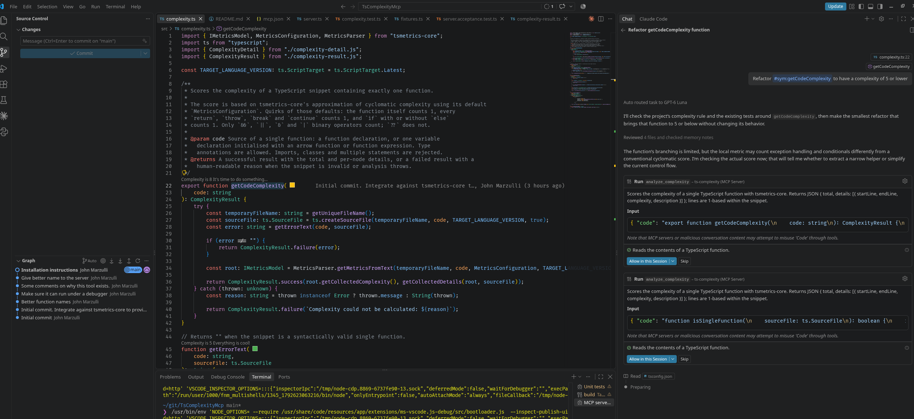

# TsComplexityMcp

TsComplexityMcp is an MCP server. It calculates the complexity of one TypeScript function.

Use this server to prevent code that is too complex.

This server is an MCP interface for the tsmetrics-core package by Tamas Kiss: <https://github.com/kisstkondoros/tsmetrics-core>.

Adding a rule in your AGENTS.md file to limit complexity to 12 or lower. Ask your LLM to reduce complexity.



## Installation

### Requirements

- TypeScript.
- Node.js version 20 or higher.
- npm.
- Git.

### Install the server

1. Examine the Node.js version. Enter this command:

   ```sh
   node --version
   ```

   Make sure that the version is 20 or higher.

2. Clone the repository. Enter this command:

   ```sh
   git clone https://github.com/JohnMarzulli/TsComplexityMcp.git
   ```

3. Go to the repository directory. Enter this command:

   ```sh
   cd TsComplexityMcp
   ```

4. Install the dependencies. Enter this command:

   ```sh
   npm install
   ```

5. Build the server. Enter this command:

   ```sh
   npm run build
   ```

6. Do the tests. Enter this command:

   ```sh
   npm test
   ```

   Make sure that no tests fail.

### Add the server to an MCP client

1. Find the full path of the server file. Enter this command in the repository directory:

   ```sh
   echo "$PWD/dist/server.js"
   ```

2. Open the MCP configuration file of your MCP client.
3. Add the server to the configuration file. Use the full path from step 1.

   For Visual Studio Code, use the file `~/.config/Code/User/mcp.json`:

   ```json
   {
     "servers": {
       "ts-complexity": {
         "type": "stdio",
         "command": "node",
         "args": ["</full/path/to>/TsComplexityMcp/dist/server.js"]
       }
     }
   }
   ```

   For MCP clients that use the `mcpServers` key, use this example:

   ```json
   {
     "mcpServers": {
       "ts-complexity": {
         "command": "node",
         "args": ["</full/path/to>/TsComplexityMcp/dist/server.js"]
       }
     }
   }
   ```

4. Save the configuration file.

5. Start the server. In Visual Studio Code, do these steps:

   1. Open the Command Palette.
   2. Select **MCP: List Servers**.
   3. Select **ts-complexity**.
   4. Select **Start Server**.

6. Make sure that the tool `analyze_typescript_complexity` is in the list of tools.

NOTE: The MCP client starts the server process. Do not start `dist/server.js` in a terminal.
